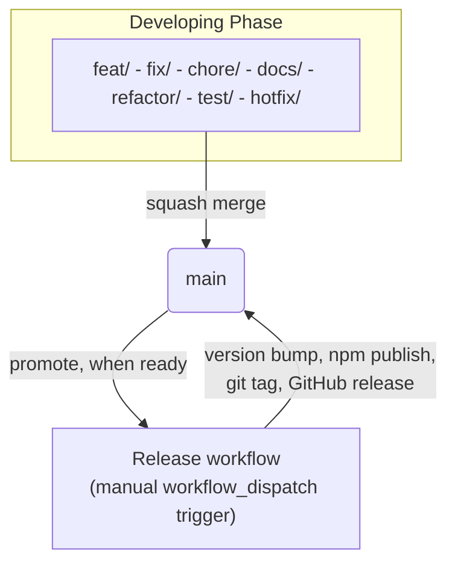

# Contributing to ARM JS Library

Thank you for your interest in contributing! Please read through this guide before submitting any contributions.

---

## Table of Contents

- [Getting Started](#getting-started)
- [Branch Purposes](#branch-purposes)
- [Branch Flow](#branch-flow)
- [Branch Naming Convention](#branch-naming-convention)
- [Commit Message Convention](#commit-message-convention)
- [Development Workflow](#development-workflow)
- [Testing](#testing)
- [Pull Request Process](#pull-request-process)
- [Labels](#labels)
- [Code Standards](#code-standards)

---

## Getting Started

### Prerequisites

- Node.js >= 20.0.0
- Yarn 1.22.22

### Setup

```bash
# Clone the repository
git clone https://github.com/michaeljymsgutierrez/arm-js-library.git
cd arm-js-library

# Install dependencies
cd packages
yarn install

# Run tests to verify setup
yarn test

# Build the library
yarn build
```

---

## Branch Purposes

`main` is the only permanent branch of this repository (trunk-based). It is never deleted, and every change - features, fixes, and hotfixes alike - reaches it the same way: a reviewed, squash-merged pull request. `main` is never force-pushed or rebased; it only ever moves forward.

---

## Branch Flow



### Developing Phase

All work branches - including hotfixes - are created from `main` and merged back into `main` via a squash-merged pull request. There is no separate base branch for hotfixes; an urgent fix follows the same path, just promoted sooner.

### Promoting Phase

`main` can collect several merged PRs before anyone promotes a release - merging does not publish anything by itself. When ready to ship, a maintainer manually triggers the `Release` GitHub Actions workflow (`workflow_dispatch`), which runs [`semantic-release`](https://semantic-release.gitbook.io/): it inspects the Conventional Commits made since the last release to decide the version bump, rebuilds `dist/`, `DOCS.md`, and `types/`, publishes to npm, tags the release, and commits the version bump back to `main`.

No file needs manual version edits - `packages/package.json` is the single source of truth, and everything else (the npm badge, the library's own `X-Powered-By` header) derives from it automatically.

---

## Branch Naming Convention

Branches must follow this format:

```
type/short-description
```

| Type        | When to use                               |
| ----------- | ----------------------------------------- |
| `feat/`     | New feature                               |
| `fix/`      | Bug fix                                   |
| `chore/`    | Maintenance tasks (deps, config, cleanup) |
| `docs/`     | Documentation only changes                |
| `refactor/` | Code restructuring, no behavior change    |
| `test/`     | Adding or updating tests                  |
| `hotfix/`   | Urgent fix for production issues          |

**Examples:**

- `feat/record-pagination`
- `fix/alias-not-updating`
- `chore/packages-dependency-updates`
- `docs/add-contributing-guide`
- `refactor/collection-manager`
- `test/query-record-coverage`
- `hotfix/save-method-crash`

---

## Commit Message Convention

This project follows the [Conventional Commits](https://www.conventionalcommits.org) specification.

```
type(scope): description
```

| Type       | When to use                            |
| ---------- | -------------------------------------- |
| `feat`     | New feature                            |
| `fix`      | Bug fix                                |
| `chore`    | Maintenance, no production code change |
| `docs`     | Documentation only                     |
| `refactor` | Code restructuring, no behavior change |
| `test`     | Adding or updating tests               |
| `style`    | Formatting, whitespace                 |
| `perf`     | Performance improvement                |
| `ci`       | CI/CD changes                          |
| `build`    | Build system or dependency changes     |

**Examples:**

- `feat(records): add pagination support`
- `fix(alias): resolve alias not updating on reload`
- `chore(deps): upgrade axios from 1.13.5 to 1.18.1`
- `docs(contributing): add CONTRIBUTING.md`
- `test(query): add coverage for queryRecord edge cases`

---

## Development Workflow

1. Fork the repository
2. Create a branch from `main` following the [Branch Naming Convention](#branch-naming-convention)
3. Make your changes in `packages/src/lib/api-resource-manager.js`
4. Write or update tests in `packages/tests/`
5. Run the test suite and ensure all tests pass
6. Submit a pull request targeting `main`

---

## Testing

All changes must pass the full test suite before submitting a PR.

```bash
cd packages

# Run tests once
yarn test

# Run tests in watch mode
yarn test:watch
```

- Write tests for any new functionality
- Ensure existing tests are not broken
- Tests live in `packages/tests/units/` organized by feature domain

---

## Pull Request Process

- Target branch: `main`
- Use the existing PR template (`.github/PULL_REQUEST_TEMPLATE.md`)
- Link any related GitHub issues
- Assign the appropriate reviewers
- Ensure CI checks pass before requesting review
- PRs are squash-merged only - keep the PR title a valid Conventional Commit, since it becomes the commit message on `main`

---

## Labels

Apply the appropriate label(s) when creating a PR or issue:

| Label | When to use |
|---|---|
| `feat` | New feature additions |
| `fix` | Bug fixes and patches |
| `chore` | Maintenance tasks, configs, and cleanups |
| `docs` | Documentation additions or improvements |
| `refactor` | Code restructuring with no behavior change |
| `deps` | Dependency updates and version bumps |
| `release` | Release preparation and versioning |
| `bug` | Confirmed bugs and reported issues |
| `experimental` | Experimental or exploratory changes |
| `javascript` | JavaScript code changes |
| `hacktoberfest-accepted` | Accepted Hacktoberfest contributions |

---

## Code Standards

- Follow the existing code patterns in `packages/src/lib/api-resource-manager.js`
- Run ESLint before submitting: `yarn build` (ESLint runs as part of the build)
- Do not leave `console.log` statements in production code
- Keep changes focused - one concern per PR
